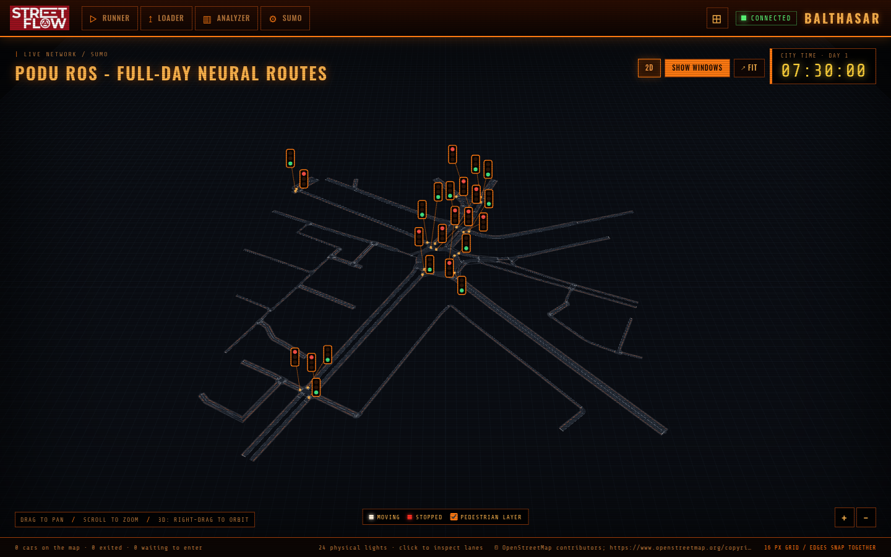
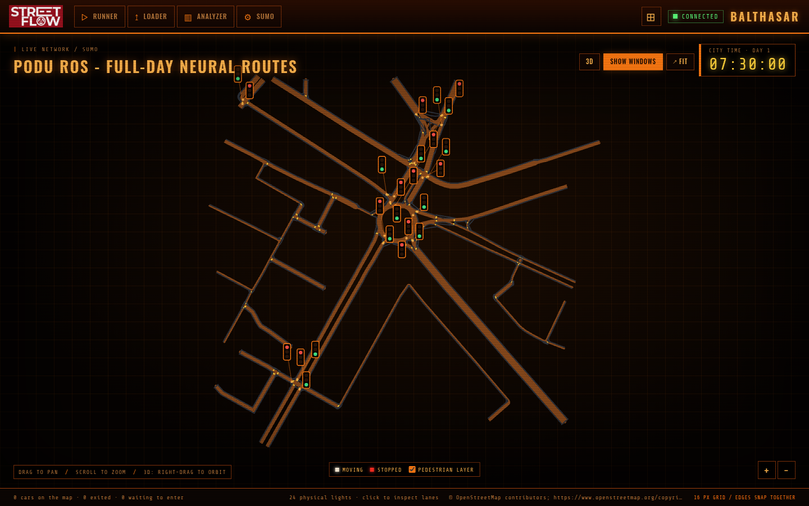
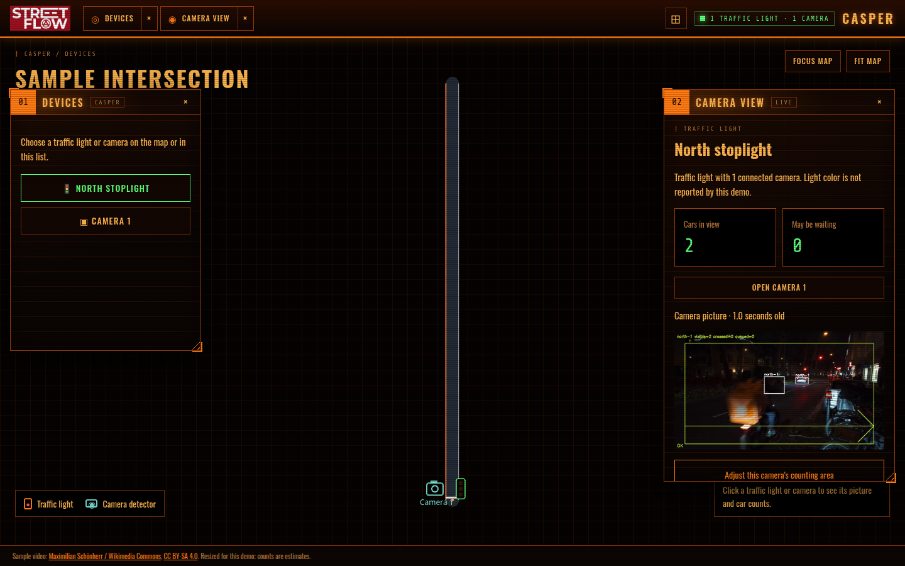
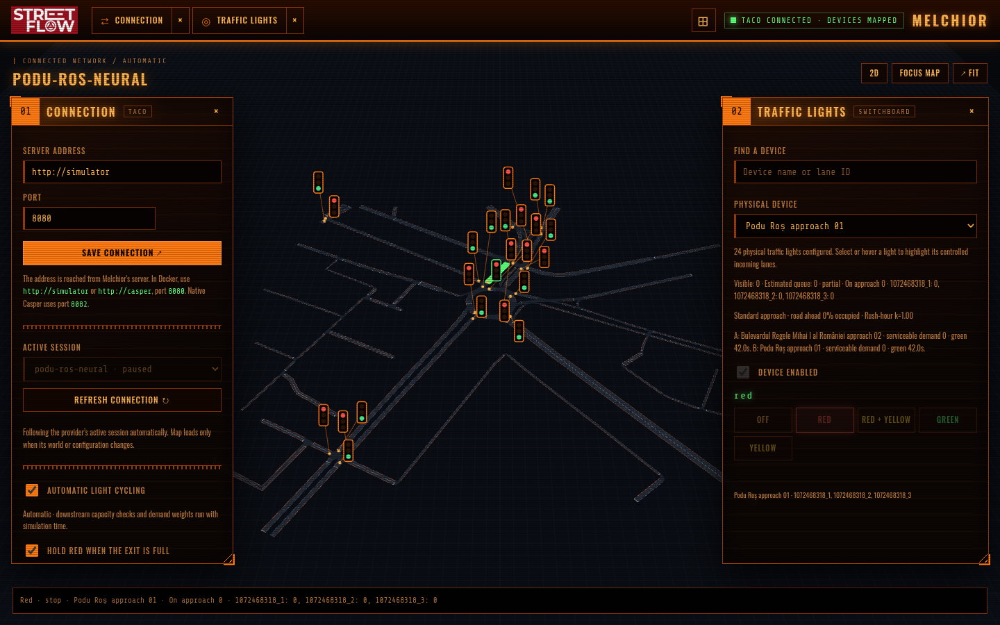
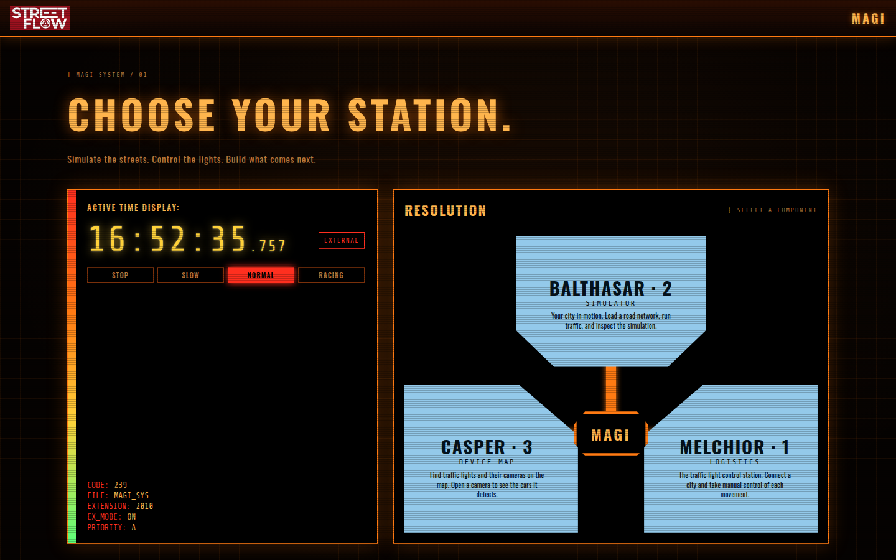

# STREETFLOW

A traffic simulation and control prototype for Iași. Load a road network, run vehicles in SUMO, inspect it in 2D or 3D, control physical traffic-light groups, and bring camera observations into the same TACO interface. The browser app brings **Balthasar**, **Melchior**, and **Casper** together as MAGI.



## Start here

**Docker Desktop demo, including the sample camera and bundled projects:**

```sh
./scripts/casper-demo.sh start
```

Open **http://localhost:8090**. Select **Balthasar** → **Loader** → **Podu Ros - full-day neural routes** → **Load**. The project opens paused; use **Runner** to start traffic. Switch between **2D** and **3D** above the map. Select **Casper** to see the looping sample camera and adjust its counting area. Select **Melchior** to inspect the loaded city's physical traffic lights. Stop the demo with `./scripts/casper-demo.sh stop`.

The launcher uses Docker Desktop's `desktop-linux` context. On first use it downloads the official YOLOX Nano model, creates a private demo token, and copies the bundled projects, video, and camera configuration into Docker volumes. It does not need Docker Desktop file sharing for this checkout. Its sample counts are estimates, not validated traffic measurements.

**Ordinary Compose stack, without the sample video worker:**

```sh
STREETFLOW_PROJECTS_DIR=./projects/drafts docker compose up --build -d --wait
```

This mounts the 11 versioned example projects directly. Use `docker --context desktop-linux compose` if your Docker CLI is pointed at a different daemon. For your own projects, put each folder or ZIP in a separate directory and set `STREETFLOW_PROJECTS_DIR` to that directory. Docker Desktop must share that host path for bind mounts. See [project loading](docs/components/simulator/project-loading.md).

| Service | Local address | Purpose |
| --- | --- | --- |
| MAGI frontend | [localhost:8090](http://localhost:8090) | Balthasar, Melchior, Casper |
| Balthasar | [localhost:8080](http://localhost:8080) | SUMO simulator and API |
| Melchior | [localhost:8081](http://localhost:8081) | TACO traffic-light controller |
| Casper | [localhost:8082](http://localhost:8082) | Camera measurements and TACO provider |

The demo launcher uses ports 18080, 18081, and 18082 for the backend services; its frontend remains on 8090. Set `FRONTEND_PORT`, `SIMULATOR_PORT`, `LOGISTICS_PORT`, or `CASPER_PORT` before starting to change host ports. The ordinary stack includes Casper, but camera data is unavailable until a worker connects.

## See it in action

| Balthasar · 2D | Casper · live sample camera |
| --- | --- |
|  |  |

| Melchior · traffic-light control | MAGI · component selector |
| --- | --- |
|  |  |

Screenshots were captured from the running `podu-ros-neural` project with the simulation paused at 07:30. The 3D map draws roads and vehicles with WebGL and keeps traffic-light markers and lane highlights visible on a projected overlay. Drag to pan, scroll to zoom, and right-drag or Shift-drag to orbit in 3D. The selected map mode is remembered in the browser.

## What is inside

| Component | What it does |
| --- | --- |
| **Balthasar** | Loads project folders or ZIPs, generates traffic, runs one SUMO simulation, and exposes maps, snapshots, run controls, and traffic-light state. Supports Edge Population, Transformer Routes, and Neural Routes projects. |
| **Melchior** | Connects through the physical-device TACO contract, enables authored signal programs automatically, offers manual light control, and can apply downstream spillback protection and rush-hour green weighting. |
| **Casper** | Receives authenticated camera measurements, maps lanes to streets and stoplights, serves traffic through TACO, and offers a camera preview and counting-area editor. A Python worker runs detection and tracking at the camera. |
| **MAGI frontend** | Serves the three browser workspaces from one origin and proxies their APIs. |

The bundled [Podu Roș neural project](projects/drafts/podu-ros-neural/README.md) includes its SUMO network, neural route model, ONNX route model, detectors, pedestrian flows, and traffic-light definitions. Other examples cover tiny intersections, four-way comparisons, central Iași, and Podu Roș variants. The source projects are versioned under `projects/drafts/`; Docker volumes hold runtime copies and saved run state. The neural demand and generated signal timings are modeled estimates, not a calibrated city forecast.

```text
Browser / MAGI frontend
  ├─ Balthasar → SUMO → simulated traffic and signal state
  ├─ Melchior  → TACO → physical traffic-light groups
  └─ Casper    ← camera worker → counts, preview, calibration
```

## Operate and develop

- In **Loader**, choose a project and load it; **Runner** starts, pauses, steps, stops, and resets the simulation. Loading another project replaces the active one. Melchior follows the active session.
- Use **Refresh** after changing a project folder. A project must have `experiment.json` at its root. The simulator scans only the immediate children of its configured projects directory.
- `docker compose stop` stops the ordinary stack; `docker compose down` removes its containers while retaining volumes. Avoid `down -v` if you want saved runs and calibration data. Use `./scripts/casper-demo.sh stop` for the Docker Desktop demo.
- Docker provides .NET 10 and SUMO. Native work needs .NET 10 and SUMO on `PATH`: `dotnet build Streetflow.slnx`, then `dotnet run --project components/simulator/Streetflow.Simulator`.
- API descriptions and deeper instructions: [simulator](components/simulator/README.md), [Melchior](components/streetflow/README.md), [Casper and camera setup](components/detector/README.md), [frontend](components/frontend/README.md), and [TACO contract](docs/components/contracts/taco.md).

The sample video is a resized version of [*Cars Passing by at Night* by Maximilian Schönherr](https://commons.wikimedia.org/wiki/File:Cars_Passing_by_at_Night.webm), [CC BY-SA 4.0](https://creativecommons.org/licenses/by-sa/4.0/). OpenStreetMap attribution for the Podu Roș network is in its project manifest. STREETFLOW is a hackathon prototype: camera counts and traffic policies need field validation before real-world use.
