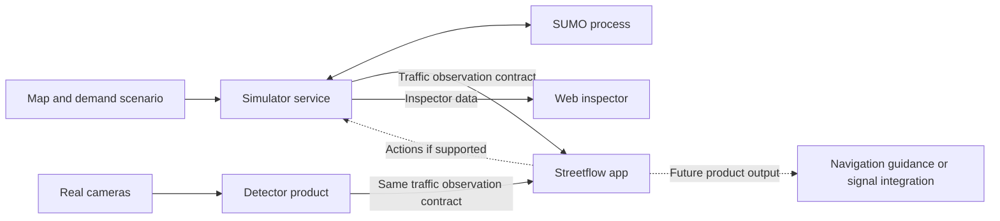

# STREETFLOW component architecture

Streetflow and the detector are the two products. The simulator is the environment for developing and evaluating Streetflow. All three communicate through explicit data contracts; they do not share internal vehicle state or an implementation language requirement.

## Responsibilities

| Component | Owns | Inputs and outputs |
| --- | --- | --- |
| Simulator | Scenario configuration, SUMO lifecycle, synthetic observations, web inspection, and experiment records | Map and demand in; observations, inspector state, and run results out; optional validated product actions in |
| Streetflow app | Traffic interpretation and product decisions | Traffic observations in; recommendations or commands out, depending on the selected product |
| Detector | Camera calibration, inference, local tracking, lane assignment, and traffic measurement | Camera video in; timestamped lane/intersection observations out |

The simulator runs independently with ordinary routes and default signal programs. Streetflow remains a separate process. The simulator does not contain Streetflow's optimizer or navigation experience. The detector need not run during a Streetflow simulation experiment.

## Development and real-world operation

In simulation, the simulator fills the detector's producer role. In real-world operation, the detector supplies those observations. Both identify the same kinds of lane, approach, intersection, and measurement region. Map revisions and explicit lane mappings make that correspondence meaningful.

Exact simulated car identities and full routes are available to the inspector and evaluator. Streetflow receives only the measurements its configured sensors could supply. A camera's local track ID is not a city-wide car identity.

## Keep the first implementation small

Build one C# / .NET 10 simulator service containing its engine adapter, observation builder, API handlers, and recorder. Start one SUMO child process and serve the future plain HTML/JavaScript browser from that service. Use one active run, REST/JSON requests, polling, a local file archive, and PostgreSQL indexing enabled by Compose. The two API surfaces are separate namespaces in that service, not separate services.

A message broker, distributed scheduler, database cluster, plugin framework, and photorealistic camera renderer are outside the first milestone. Add infrastructure only when a demonstrated requirement needs it.

## Documentation and code boundaries

Each component has a folder under `docs/` and a future code location under `components/`. The runnable original simulator is in `legacy/simulator/`. Research remains in `docs/research/`; images live under `assets/images/`. Historical proposals remain in `docs/archive/` and are not current implementation instructions.

The active simulator design excludes Python and Rust. The product languages are undecided. Preserved Python scripts belong to the legacy implementation and do not select the new stack.
