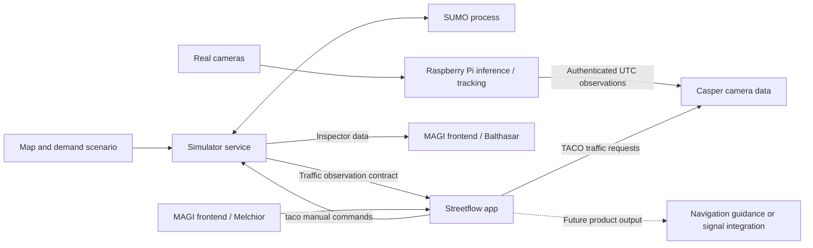

# STREETFLOW component architecture

Streetflow and the detector are the two products. The simulator is the environment for developing and evaluating Streetflow. All three communicate through explicit data contracts; they do not share internal vehicle state or an implementation language requirement.

## Responsibilities

| Component | Owns | Inputs and outputs |
| --- | --- | --- |
| Balthasar / Simulator | Scenario configuration, SUMO lifecycle, synthetic observations, and experiment records | Map/demand in; observations, inspector state, results, and taco out |
| Melchior / Streetflow logistics | Traffic light control; currently manual commands and saved target settings | taco discovery/state in; explicit signal commands out |
| Raspberry Pi camera worker | Video capture, inference, local tracking, calibration, windowed estimates | Video in; authenticated UTC observations out |
| Casper / Camera data | Camera registry, street/lane/stoplight mappings, validation, freshness | Pi observations in; TACO traffic state out |
| MAGI frontend | Pages for Balthasar, Melchior, and Casper, plus camera calibration | Browser interactions and proxied API requests |

The simulator runs independently. City runs start with lights off and road-priority rules; manual taco commands control them. Legacy scenario runs retain default signal programs. Melchior and the frontend run in separate processes. The detector need not run during simulation experiments. There is no automatic logistics management yet.

## Development and real-world operation

In simulation, the simulator fills the detector's producer role. In real-world operation, the detector supplies those observations. Both identify the same kinds of lane, approach, intersection, and measurement region. Map revisions and explicit lane mappings make that correspondence meaningful.

Exact simulated car identities and full routes are available to the inspector and evaluator. Streetflow receives only the measurements its configured sensors could supply. A camera's local track ID is not a city-wide car identity.

## Keep the first implementation small

Use separate C# / .NET 10 servers for Balthasar, Melchior, Casper, and the MAGI frontend. Balthasar owns SUMO and simulation records. Melchior uses TACO and persists its selected provider. Casper accepts camera metadata and retains bounded latest state. Python camera workers run CPU inference locally. The frontend serves plain HTML/JavaScript and proxies browser requests. REST/JSON polling is sufficient for this milestone.

A message broker, distributed scheduler, database cluster, plugin framework, and photorealistic camera renderer are outside the first milestone. Add infrastructure only when a demonstrated requirement needs it.

## Documentation and code boundaries

Each component has a folder under `docs/` and a future code location under `components/`. The runnable original simulator is in `legacy/simulator/`. Research remains in `docs/research/`; images live under `assets/images/`. Historical proposals remain in `docs/archive/` and are not current implementation instructions.

The simulator, logistics, Casper, and frontend use .NET 10. Camera workers and the separate route trainer use Python. Each component chooses its stack independently.
